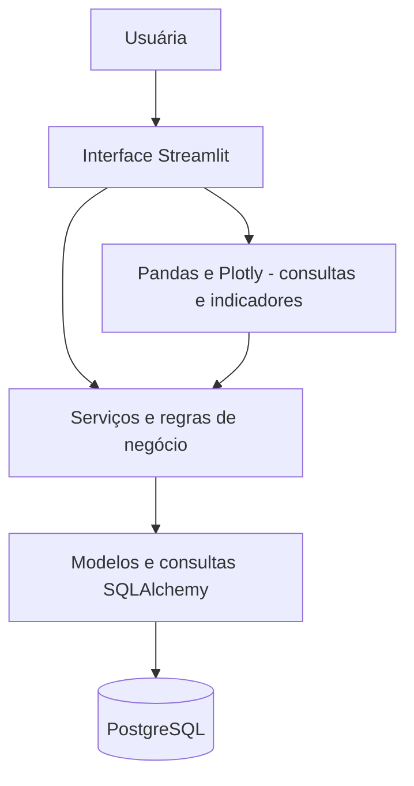

# 08 — Arquitetura inicial do EntreTrama

**Projeto:** EntreTrama  
**Status:** proposta para revisão e aprovação  
**Escopo:** arquitetura da aplicação local e incremental descrita no `07-roadmap.md`.

## 1. Objetivo e princípios

Definir uma estrutura técnica simples para desenvolver, testar e ampliar o EntreTrama, sem introduzir serviços ou dependências desnecessárias. O sistema será inicialmente utilizado por uma pessoa, com interface web executada localmente e dados persistidos no PostgreSQL.

Princípios:
- Organizar o código por responsabilidades, evitando concentrar regras de negócio nas telas.
- Implementar um módulo por vez, conforme o Roadmap.
- Manter operações que alteram dados relacionados dentro de transações.
- Usar o modelo de dados de `06-modelagem-de-dados.md` como referência, ajustando-o somente quando a implementação exigir.
- Não incluir autenticação, API separada, microsserviços ou integrações com marketplaces no MVP.

## 2. Tecnologias

| Tecnologia | Responsabilidade |
|---|---|
| Python | Linguagem principal e regras de negócio |
| Streamlit | Interface, formulários, navegação e visualizações |
| PostgreSQL | Banco de dados relacional persistente |
| SQLAlchemy | Mapeamento objeto-relacional (ORM), consultas e transações |
| Alembic | Migrações versionadas do esquema do banco |
| Pandas | Tratamento de dados para relatórios e consultas, quando necessário |
| Plotly | Gráficos e indicadores, quando necessário |
| pytest | Testes automatizados das regras de negócio e persistência |
| python-dotenv | Leitura de configurações locais a partir de `.env`, se adotado |

As versões específicas das dependências serão fixadas ao preparar o ambiente e registradas no projeto.

## 3. Visão geral da arquitetura

Aplicação única (monólito modular), com três responsabilidades principais:

1. **Apresentação:** páginas Streamlit coletam entradas, exibem dados e mostram mensagens; não calculam estoque, custo médio ou saldo financeiro por conta própria.
2. **Serviços de negócio:** validam operações e coordenam processos como confirmar compras, ajustar estoque, registrar vendas e receber pagamentos.
3. **Persistência:** modelos SQLAlchemy e consultas acessam o PostgreSQL por sessões controladas.



**Fluxo de escrita:** formulário → serviço → validação → transação SQLAlchemy → PostgreSQL → retorno à interface.  
**Fluxo de leitura:** página → serviço/consulta → banco → apresentação; Pandas/Plotly podem apoiar indicadores, sem se tornarem fonte principal dos dados.

## 4. Estrutura inicial de diretórios

```text
EntreTrama/
├── app.py                     # Entrada da aplicação Streamlit
├── pages/                     # Páginas da interface
│   ├── 01_Materiais.py
│   ├── 02_Compras.py
│   ├── 03_Vendas.py
│   └── 04_Financeiro.py
├── entretrama/
│   ├── __init__.py
│   ├── config.py              # Configuração e variáveis de ambiente
│   ├── db/
│   │   ├── __init__.py
│   │   ├── base.py            # Base declarativa SQLAlchemy
│   │   └── session.py         # Engine e sessões
│   ├── models/                # Entidades persistidas
│   │   ├── __init__.py
│   │   ├── materiais.py
│   │   ├── compras.py
│   │   ├── produtos.py
│   │   ├── vendas.py
│   │   └── financeiro.py
│   ├── services/              # Operações e regras de negócio
│   │   ├── __init__.py
│   │   ├── materiais.py
│   │   ├── compras.py
│   │   ├── vendas.py
│   │   └── financeiro.py
│   └── queries/               # Consultas reutilizáveis e relatórios
│       └── __init__.py
├── migrations/                # Migrações Alembic (geradas na fundação)
├── tests/                     # Testes automatizados
├── docs/                      # Documentação do projeto
├── .env.example               # Nomes das variáveis, sem credenciais
├── .gitignore
├── requirements.txt           # Dependências fixadas
└── alembic.ini                # Configuração das migrações
```

Essa é a **estrutura-alvo inicial**, não uma afirmação de que esses arquivos já existem. Criar apenas os diretórios e arquivos necessários a cada etapa. Páginas adicionais de fornecedores, clientes, produtos, produção, entregas e indicadores serão incorporadas conforme o Roadmap.

## 5. Organização dos módulos

| Módulo | Principais responsabilidades | Etapa |
|---|---|---|
| Materiais e estoque | Materiais, variações, unidades, saldo, movimentações e ajustes | 1 |
| Fornecedores e compras | Fornecedores, itens, conversão de embalagens, confirmação e custo médio | 1 |
| Produtos e clientes | Cadastros básicos | 1 |
| Vendas | Vendas, itens, descontos, frete e taxas | 1 |
| Financeiro | Contas a pagar/receber, pagamentos, recebimentos parciais e saldos | 1 |
| Consultas e indicadores | Visões de estoque, contas pendentes e movimentos | 1 |
| Fichas técnicas e produção | Componentes, configurações, ordens e consumo | 2 |
| Produtos acabados e entregas | Lotes, reservas, alocações e entregas | 3 |

Os módulos compartilham o mesmo banco, mas suas regras devem permanecer em serviços próprios. Quando uma operação envolve mais de um módulo, um serviço coordenador controla a transação completa.

## 6. Modelos SQLAlchemy e banco de dados

- Uma única `Base` declarativa compartilhada pelos modelos.
- Classes de modelo agrupadas por domínio em `entretrama/models/`, conforme entidades de `06-modelagem-de-dados.md`.
- Cada entidade define sua chave primária, chaves estrangeiras, restrições e relacionamentos aplicáveis.
- IDs do tipo `INTEGER` por padrão, salvo necessidade futura justificada; valores monetários e quantidades decimais usam `NUMERIC` no PostgreSQL e `Decimal` em Python, não `float`.
- Regras que dependem de vários registros (por exemplo, confirmar compra e gerar movimentos) ficam nos serviços e são executadas atomicamente.
- Não duplicar saldos derivados quando puderem ser calculados de movimentações e lançamentos; quando houver otimização posterior, definir mecanismo de consistência.

A implementação começa pelas entidades necessárias à Etapa 1. As demais entidades documentadas serão criadas nas etapas correspondentes.

## 7. Conexão, sessões e transações

- A URL do banco será lida da variável de ambiente `DATABASE_URL`.
- O módulo `entretrama/db/session.py` criará o `engine` SQLAlchemy e uma fábrica de sessões.
- Cada operação de negócio abrirá uma sessão, realizará as validações e confirmará (`commit`) **uma única transação** quando todos os passos forem bem-sucedidos.
- Em caso de erro, a operação fará `rollback`, preservando a consistência dos dados.
- As páginas Streamlit não devem manter uma sessão transacional aberta indefinidamente entre interações.
- O banco será acessado por um usuário PostgreSQL próprio da aplicação, com permissões adequadas ao ambiente local.

**Exemplo de regra transacional:** confirmar uma compra registra seus itens, atualiza os movimentos físicos de estoque e os custos médios correspondentes na mesma operação; se algum passo falhar, nenhum desses efeitos deve ser confirmado parcialmente. O pagamento da compra é independente da entrada física de materiais.

## 8. Configurações e segurança básica

- `.env` local conterá `DATABASE_URL` e outras configurações que venham a ser necessárias.
- `.env` será ignorado pelo Git; `.env.example` documentará somente os nomes das variáveis e valores fictícios.
- Credenciais não serão escritas em arquivos versionados nem em telas.
- Dados reais do negócio devem ser preservados por cópias de segurança periódicas do PostgreSQL, a serem configuradas antes do uso contínuo.
- O sistema é inicialmente local e de usuário único; não presumir segurança para exposição pública na internet.

## 9. Criação e evolução das tabelas

Adotar **Alembic** para versionar alterações no esquema:

1. Configurar SQLAlchemy, PostgreSQL e Alembic na Etapa 0.
2. Criar a migração inicial apenas para as entidades necessárias ao primeiro fluxo funcional.
3. Revisar o conteúdo das migrações antes de executá-las.
4. Aplicar migrações ao banco local e testar inserção e consulta.
5. Criar novas migrações para alterações posteriores, preservando os dados existentes.

Evitar usar `Base.metadata.create_all()` como mecanismo permanente de evolução do esquema. Não apagar e recriar tabelas que já contenham dados reais para resolver mudanças estruturais.

## 10. Testes e critérios de aceitação da fundação

A fundação técnica estará concluída quando:

- [ ] Ambiente Python e dependências estiverem configurados.
- [ ] PostgreSQL estiver disponível e acessível com credenciais locais.
- [ ] `DATABASE_URL` for lida corretamente sem expor senhas no repositório.
- [ ] SQLAlchemy conseguir abrir sessão e executar uma consulta simples.
- [ ] Alembic conseguir aplicar uma migração inicial.
- [ ] Streamlit iniciar localmente e exibir uma página funcional.
- [ ] Uma operação de teste gravar e recuperar dados persistidos.
- [ ] Um teste de erro confirmar que uma transação incompleta é revertida.

As regras específicas de cada módulo terão testes próprios, de acordo com os critérios do `07-roadmap.md`.

## 11. Limites e decisões adiadas

- Não implementar autenticação, permissões multiusuário, API REST separada, filas ou microsserviços neste momento.
- Não criar antecipadamente todas as telas ou tabelas previstas na modelagem completa.
- A forma de implantação fora do computador local será definida quando houver necessidade real de acesso remoto.
- Relatórios complexos e melhorias visuais não bloqueiam a entrega dos fluxos essenciais.

## 12. Próximo passo

Após aprovação e commit deste documento, iniciar a **Etapa 0 — Fundação técnica** do Roadmap. O primeiro objetivo executável é iniciar o Streamlit, conectar ao PostgreSQL e persistir/consultar um registro de teste. Depois, começar pelo cadastro de materiais e variações.
